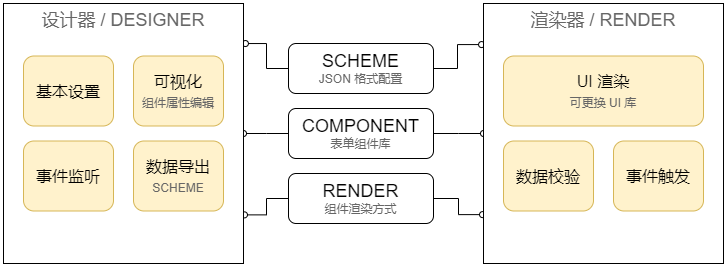

<div align=center>
<h1> 格子表单 / GRID-FORM </h1>


</div>

基于 GRID 布局的简单表单工具（包含可视化设计器、渲染器），默认组件库为 [Naive UI](https://www.naiveui.com)。

此工具仅适用于布局简单纯粹的表单场景 😄

在线文档及演示：👉[Github Pages](https://0604hx.github.io/grid-form/) 、[个人站点（推荐）](https://demo.0604hx.top/grid-form/)👈

包名|说明|进度|版本
-|-|-|-
common|通用工具|✅|
designer|可视化设计器（基于 Naive UI）|✅|
render-naive|基于[Naive UI](https://www.naiveui.com)实现的渲染器|✅|
render-element|基于[Element Plus](https://element-plus.org/zh-CN/)实现的渲染器|✅|
render-vant|基于[Vant4](https://vant-ui.github.io)实现的渲染器|✅|
render-varlet|基于[varlet](https://github.com/varletjs/varlet)实现的渲染器|✅|
render-tree|简单树形结构渲染器（Web Components）|✅|

**说明：** Web Components 渲染器可以在任何 web 项目中使用（不限于 vue 环境）😄

**相关博文**

* [基于 VUE3 可视化低代码表单设计器](https://blog.csdn.net/ssrc0604hx/article/details/128825163)
* [嵌套子表单与自定义脚本交互](https://blog.csdn.net/ssrc0604hx/article/details/135828101)
* [文档网站搭建（VitePress）与部署（Github Pages）](https://blog.csdn.net/ssrc0604hx/article/details/135970166)
* [必填项检验 BUG 修复实录](https://blog.csdn.net/ssrc0604hx/article/details/136617743)

## 1. 总览 / OVERVIEW



更多截图请看 [screenshot](docs/screenshot)

## 2. 开始使用 / GETTING STARTED

### 2.1 仅使用渲染器
> 详细文档见：[render.md](packages/site/guide/render.md)

1. 安装依赖

```shell
npm i -S @grid-form/render-naive
```

2. 使用渲染器组件

```html
<FormRender :renders="RenderFuncs" :form="form" debug
    @submit="onSubmit" @failed="onFailed" />
```

```javascript
import { FormRender, RenderFuncs } from "@grid-form/render-naive"

// 如需扩展 RenderFuncs 请自行扩写
// 表单对象通常来自后端，详细数据结构请查看 packages/example/src/views/渲染器.vue
let form = reactive({})
```

#### 2.1.1 表单项默认值
> 我们可以通过`${xxxx}`的格式设置（注意，前后不能有其他字符）表单项的默认值，渲染过程中会将占位符替换为计算后的值

```javascript
//默认使用的计算函数
import { formValueProvider } from "@grid-form/common"

import dayjs from 'dayjs'

/*
扩展默认的表单默认值计算器
支持 Promise （未作异常捕获，慎用）
*/
formValueProvider["${date}"]        = ()=> dayjs(new Date()).format("YYYY-MM-DD")
formValueProvider["${username}"]    = ()=> "集成显卡"

//详见 packages\example\src\views\渲染器.vue
```

#### 2.1.2 内置组件
> 业务系统可自行扩展自定义组件

组件名称|说明|Naive UI|Element Plus|Vant4|Varlet
-|-|-|-|-|-
文本输入|支持TEXTAREA|✅|✅|✅|✅
数值输入|仅限数字|✅|✅|✅|✅
动态标签|标签组输入（Array）|✅|✅||
`按钮`|可用于交互操作|✅|✅|✅|✅
日期选择||✅|✅|✅|✅
下拉选择（Select）|支持多选|✅|✅|✅|✅
单选框（Radio）||✅|✅|✅|✅
开关（Switch）|布尔值|✅|✅|✅|✅
多选框（Checkbox）||✅|✅|✅|✅
星级评分（Rate）|数值|✅|✅|✅|✅
颜色选择器||✅|✅||
文件上传|按指定格式读取内容|✅|✅|✅|✅
静态文本|支持HTML|✅|✅|✅|✅
信息框|标题+正文，支持HTML|✅|✅|✅|✅
分割线||✅|✅|✅|✅
`图片展示`||✅|✅|✅|✅
静态表格|简单的二维数据展示表格|✅|✅|✅|✅
子容器（Card）|嵌套容器|✅|✅|✅|✅

注意：上述组件`特殊标注`则表示支持自定义脚本

### 2.2 使用设计器
> 设计器依赖 render-naive

```shell
npm i -S @grid-form/designer @grid-form/render-naive
```

```html
<Designer :renders="RenderFuncs" :components="Components" :form="form" 
    debug show-footer style="height: 100%;" />
```

```javascript
import { reactive } from 'vue'
import { Designer, Components } from "@grid-form/designer"
import { RenderFuncs } from "@grid-form/render-naive"
import { createForm } from "@grid-form/common"

// 如需扩展 RenderFuncs、Components ，请自行扩写
let form = reactive(createForm())
```


## 3. 数据结构 / DATA STRUCTURE

详见：[data-structure.md](packages/site/guide/data-structure.md)

## 4. 开发 / DEVELOPMENT
> 本项目采用 `pnpm` 进行管理，请确保相应环境已安装

```shell
# 拉取最新代码
git clone https://github.com/0604hx/grid-form

# 安装依赖
pnpm i
# 如果网络卡顿，可以使用镜像
pnpm i --registry https://registry.npmmirror.com/

# 运行示例（基于 VitePress）
pnpm site

# 执行成功后，浏览器访问 http://localhost:8080 即可访问首页
# 即可体验可视化设计器以及各个组件库对应的渲染效果
```

### 4.1 更新日志

详见：[更新日志/changelog](https://0604hx.github.io/grid-form/guide/changelog)

## 5. 附录 / ABOUT

### 5.1 说明

1. 此组件仅为个人学习
2. LOGO 来自[阿里巴巴矢量图标库](https://www.iconfont.cn/)

### 5.2 主流选型
> 这里列出可二次开发的, 同时具备表单渲染、表单设计的工具（截止至 2022年底）

方案 | 框架 | UI库 | 备注
---------|----------|---------|---------
[formilyjs](https://formilyjs.org)|React、Vue|AntD、Element、Vant等主流|`校验`、`事件交互`阿里巴巴开源的表单设计工具体系，能做到一份表单设计多端适配；但是对 **vue3** 支持不完备（设计器得自己做）
[FormMaking](https://form.making.link/#/zh-CN/)|VUE|AntD、Element|`校验`、`事件交互`操作良好，需要高级版本才支持 **vue3**
[form-generator](https://github.com/JakHuang/form-generator)|VUE|Element|`校验` 操作良好，预览不友好（不够直接爽快），目前不支持**vue3**
[form-create](http://form-create.com/v3/guide/)|VUE|iView、AntD、Element、Naive UI|`校验`操作良好，支持多个 UI 框架，对 **vue 2/3** 均支持，无设计器
[VForm](https://www.vform666.com/document3.html)|VUE|Element|`校验`、`事件交互` 操作良好，开源版不支持**数据源**、**子表单**

